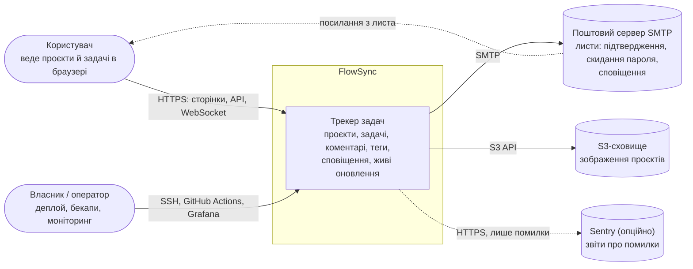
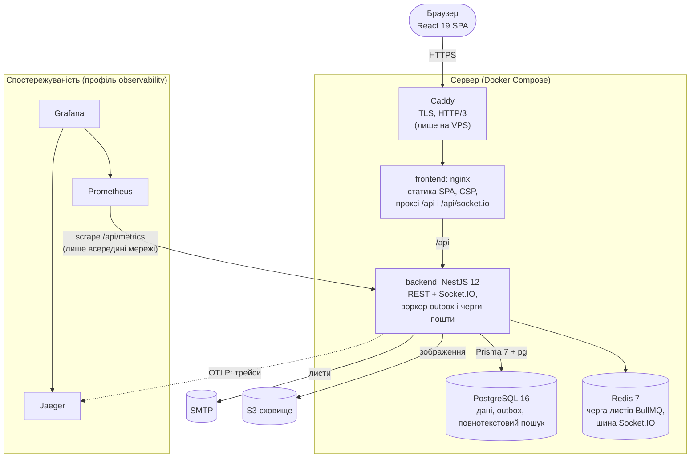
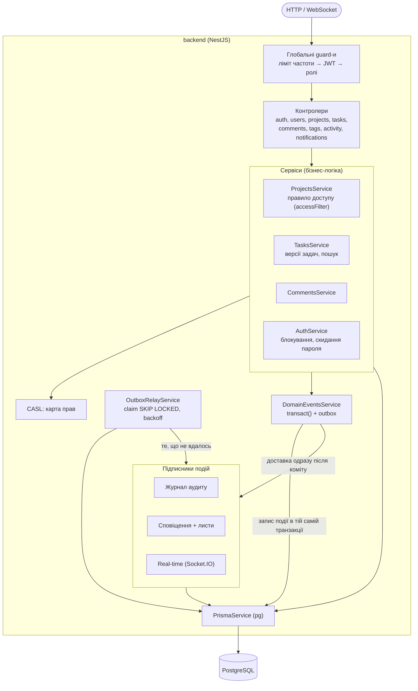
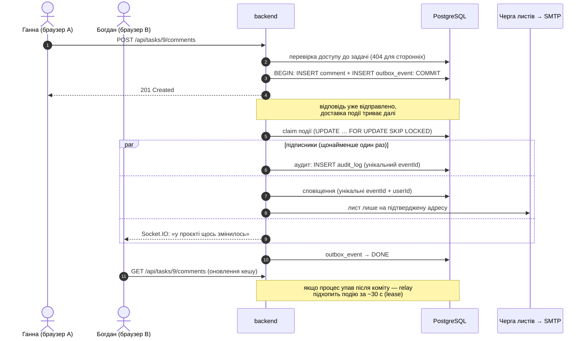
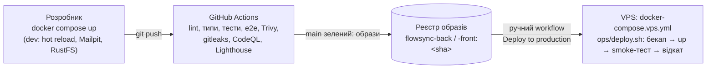

# FlowSync — архітектура (C4)

Діаграми за моделлю C4: від картини зверху (хто користується системою) до компонентів усередині backend. GitHub малює блоки
Mermaid прямо в Markdown. Деталі рішень — у `docs/adr/`, процеси й аварії — у `docs/RUNBOOK.md`, цифри продуктивності — у `docs/PERFORMANCE.md`.

## 1. Контекст: хто й навіщо

Пошта — окремий канал довіри: на ньому тримаються скидання пароля й підтвердження адреси (див. `docs/THREAT_MODEL.md`).

## 2. Контейнери: з чого складається система

| Контейнер | Відповідальність | Чого **не** робить |
|---|---|---|
| nginx | віддає SPA, ставить заголовки безпеки (CSP), проксіює `/api` | не виставляє `/api/metrics` назовні (404) |
| backend | уся бізнес-логіка, авторизація, права, події, листи | не зберігає стан сесії в пам'яті (токени в БД) |
| PostgreSQL | єдине джерело правди; outbox лежить у тій самій БД | не публікується назовні |
| Redis | необов'язковий: черга листів і шина між інстансами API | без нього все працює, але на одному інстансі й без повторів листів |

## 3. Компоненти backend

Ключові правила (деталі в `backend/AGENTS.md` і `docs/adr/`):

- Контролер тонкий; сервіс перевіряє доступ першим, повертає `select`-ом, ніколи сутність цілком.
- Усі зміни даних публікують події **в тій самій транзакції** (ADR 37); підписники ідемпотентні.
- Модулі спілкуються лише через експортовані сервіси; «хто бачить проєкт» визначає тільки `ProjectsService` (ADR 24).

## 4. Динамічна картина: новий коментар від запиту до екрана

## 5. Розгортання

Деплой на VPS ще не виконувався (за вказівкою власника); усе до нього готове й перевірене локально (`docs/OPERATIONS.md`).
