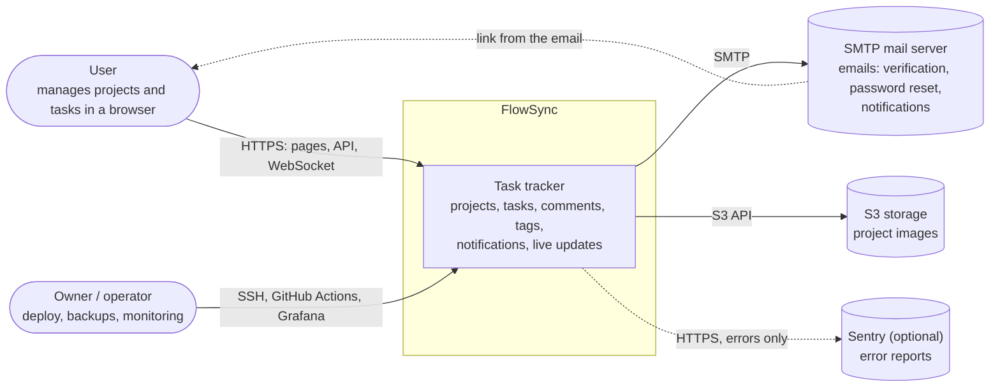
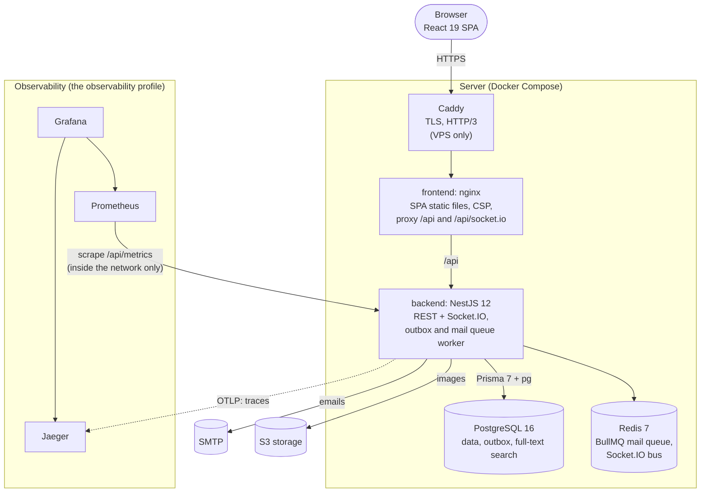
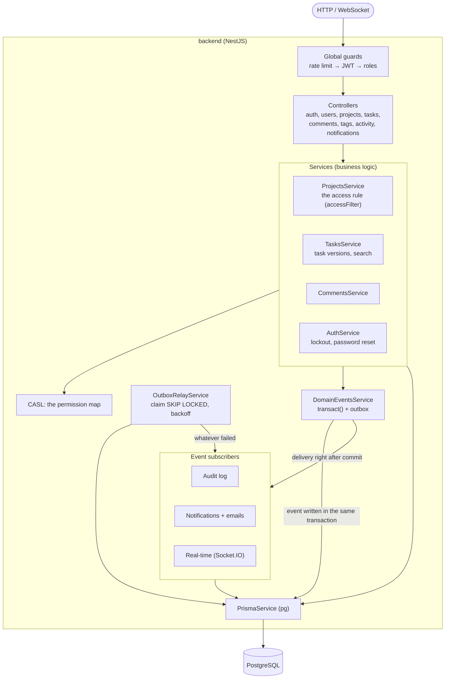
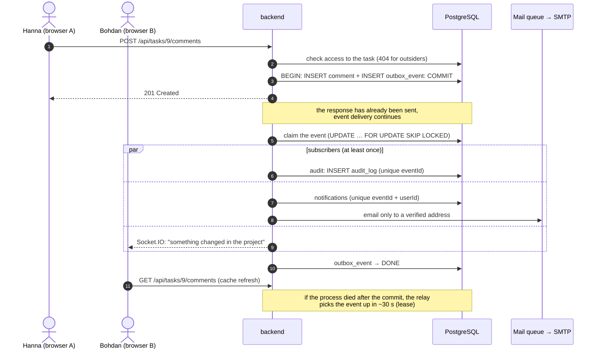
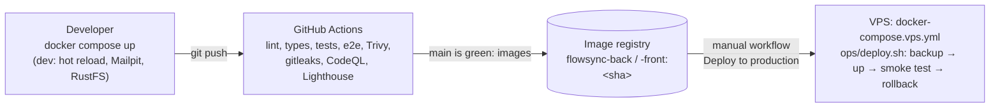

# FlowSync — architecture (C4)

Diagrams following the C4 model: from the big picture (who uses the system) to the components inside the backend. GitHub renders Mermaid
blocks right in Markdown. Decision details are in `docs/adr/`, processes and incidents in `docs/RUNBOOK.md`, performance numbers in `docs/PERFORMANCE.md`.

## 1. Context: who and why

Email is a separate trust channel: password reset and address verification rely on it (see `docs/THREAT_MODEL.md`).

## 2. Containers: what the system consists of

| Container | Responsibility | What it does **not** do |
|---|---|---|
| nginx | serves the SPA, sets security headers (CSP), proxies `/api` | does not expose `/api/metrics` to the outside (404) |
| backend | all business logic, authorization, permissions, events, emails | does not keep session state in memory (tokens are in the DB) |
| PostgreSQL | the single source of truth; the outbox lives in the same DB | is not published to the outside |
| Redis | optional: the mail queue and the bus between API instances | without it everything works, but on one instance and without email retries |

## 3. Backend components

Key rules (details in `backend/AGENTS.md` and `docs/adr/`):

- A controller is thin; a service checks access first and returns via `select`, never a whole entity.
- All data changes publish events **in the same transaction** (ADR 37); subscribers are idempotent.
- Modules talk only through exported services; "who can see a project" is decided only by `ProjectsService` (ADR 24).

## 4. The dynamic picture: a new comment from request to screen

## 5. Deployment

The VPS deploy has not been performed yet (at the owner's instruction); everything leading up to it is ready and verified locally (`docs/OPERATIONS.md`).
